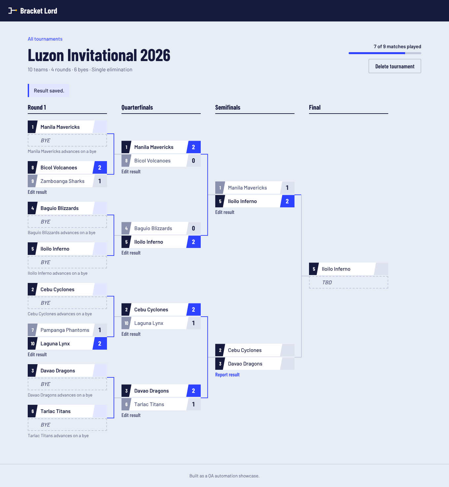

# Bracket Lord 🏆

[](https://github.com/666yunoGASAI/bracket-lord/actions/workflows/ci.yml)

**An esports tournament bracket manager, and the test automation suite that keeps it honest.**

I built Bracket Lord to show how I approach quality end to end: finding where an app is most likely to break, then building automation at the right layer to catch it. The app is small on purpose. The bracket rules (byes, seeding, results that change other results) are where the bugs hide.

> **Live demo:** _https://bracket-lord.vercel.app/_ · 



---

## The app

Run single-elimination tournaments for 2–64 teams in the browser:

- Create a tournament, paste a team list, and seed it as entered or at random
- The bracket is generated automatically, with **byes for the top seeds** when the team count isn't a power of two
- Report scores or forfeits, and winners advance on their own
- **Edit any past result.** If the winner changes, every later result that depended on it is cleared
- Everything is saved in the browser (localStorage)

## Test strategy at a glance

| Layer | Tool | Tests | What it proves |
|---|---|---|---|
| Unit | Vitest | 38 | Every bracket rule, validation message and edge case behaves exactly as specified |
| Property-based | fast-check | 6 properties × hundreds of random runs | Rules that must **always** hold do hold, for every team count from 2 to 64 and any combination of results |
| End-to-end | Playwright + TypeScript | 39 scenarios × 4 browsers | Real user flows work in Chromium, Firefox, WebKit and mobile Chrome, against the production build |
| CI | GitHub Actions | Every push and PR | Nothing merges with a failing test. HTML reports are uploaded for every browser |

Full scope, risks and the test case list are in **[docs/TEST_PLAN.md](docs/TEST_PLAN.md)**.

## Highlights worth a closer look

**1. Property-based testing for the bracket logic** ([`bracket.property.test.ts`](tests/unit/bracket.property.test.ts))
Example-based tests only check the cases I thought of. Property tests generate random tournaments and random results, then check invariants such as:
- every team appears exactly once in round 1
- byes always go to the highest seeds
- seeds 1 and 2 can only meet in the final
- a complete set of results always produces exactly one champion, after exactly *n − 1* matches
- after **editing** any result, every later match still holds the winners of its two feeder matches

**2. Page objects + component objects** ([`tests/e2e/pages`](tests/e2e/pages))
`BracketPage` exposes `match('r1-m1')`, which returns a `MatchCard` component object. Specs read like test cases (`match.winnerName()`, `dialog.forfeit('Manila Mavericks')`), and when the UI changes, I update one file instead of every spec.

**3. Starting tests from any state, instantly** ([`fixtures/test.ts`](tests/e2e/fixtures/test.ts))
A `seedTournaments` fixture writes data into localStorage with `page.addInitScript` *before the app loads*. A test that needs a finished tournament starts there directly, without clicking through 7 matches. A sessionStorage guard makes sure seeding happens only once, so `page.reload()` tests the app's own saved data and not the seed.

**4. Data-driven tests** ([`tests/e2e/data`](tests/e2e/data))
Bracket sizes, invalid form inputs and invalid scores are tables of test data. Adding a case is one line, and each row shows up as its own named test in the report.

**5. Selectors that survive refactors**
Role- and label-based locators first (`getByRole`, `getByLabel`), which double as a basic accessibility check. `data-testid` is used only where there is no meaningful role.

**6. Testing what users actually get**
The E2E suite runs against `vite build` + `vite preview`, not the dev server. CI forbids `test.only`, retries on CI only, and keeps traces, screenshots and videos for failures.

## Run it locally

Requires **Node.js 20+**.

```bash
npm install
npx playwright install        # downloads the test browsers (first time only)

npm run dev                   # app at http://localhost:5173
npm run test:unit             # unit + property tests
npm run test:e2e              # full E2E suite, all 4 browser projects
npm run test:e2e:smoke        # just the @smoke tests
npm run test:e2e:ui           # Playwright UI mode: watch tests run step by step
npm run test:e2e:report       # open the last HTML report
```

## Project structure

```
src/
  lib/bracket.ts           # pure bracket logic: seeding, byes, results, cascade
  lib/storage.ts           # localStorage persistence (never throws)
  pages/, components/      # React UI
tests/
  unit/                    # Vitest: example-based + property-based
  e2e/
    pages/                 # page objects + component objects
    fixtures/test.ts       # custom fixtures (page objects, storage seeding)
    data/                  # test data, builders, data-driven tables
    specs/                 # the actual E2E tests
docs/TEST_PLAN.md          # scope, risks, approach, test case inventory
.github/workflows/ci.yml   # typecheck → unit → E2E matrix (4 browsers)
```

## What I'd add next

- Double-elimination format (losers' bracket), with property tests for it
- Automated accessibility checks with axe-core
- Visual regression snapshots of the bracket layout

